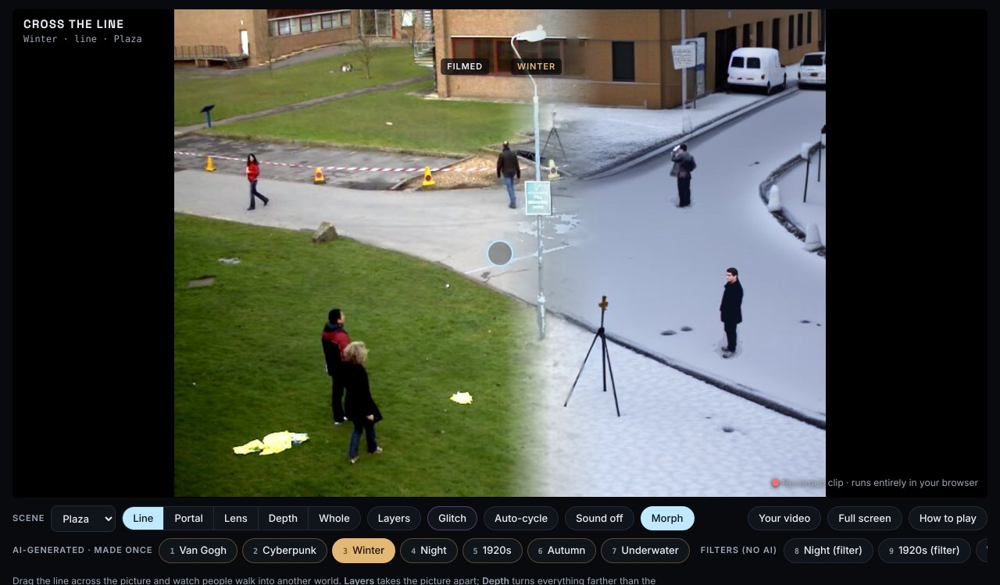

# Cross the Line

**Film from a tripod, pick AI worlds, and choose where each one shows. Each world is drawn once, so it never flickers, and the real people stay real.**

[Try it in the browser](https://claude.ai/artifact/X5CC9ZXuQ7xwdemQcU9apw) · demo video (coming) · UC Berkeley CS180/280A final project, Fall 2026



## What it is

Cross the Line is a browser tool for videos shot from a fixed camera. It redraws the empty scene as AI worlds such as winter, night, the 1920s or a Van Gogh painting. You decide where each world shows: paint it on with a brush, or put it on one side of a line, inside a ring on the ground, under a lens, or over the whole frame. The real people are cut out of the video and put back, tinted to the light of the world they stand in. Anyone who walks across the line walks into another world.

Today's AI video tools redraw every frame. That is slow, it flickers, and it changes people's faces. With a tripod, every frame shares one background, so we redraw that background once.

## Using it

1. **Load a scene:** one of three recorded clips, or your own tripod video ("Your video").
2. **Pick a world:** generated once by Stable Diffusion, a colour filter, or an image you drop in.
3. **Choose where it shows:** **Paint** it on (right-drag erases, scroll sizes the brush), or pick Line, Portal (a ring on the ground), Lens or Whole frame and drag to move it.
4. **Watch:** people take on the world's light as they cross into it. **Layers** shows how each frame is built.

## The demo video (60–90 s, a screen recording of the interface)

| Time | What you see |
|---|---|
| 0:00 | The plaza plays, untouched. |
| 0:05 | Pick Winter and drag the line in. Walkers cross into the snow. |
| 0:20 | Switch to Portal: a ring of Van Gogh on the ground that people step into. |
| 0:35 | Paint: brush snow onto the lawn, then erase a path through it. People turn wintry as they step onto the paint. |
| 0:50 | Layers: the filmed frame, the empty scene, the world, the people, the mask, the result. |
| 1:05 | "Your video": drop a clip, the empty scene appears, pick a world. |
| 1:20 | Export and play the result (coming). |

## The pitch (2 minutes)

1. **The problem.** AI video tools redraw every frame on large GPUs. Buildings shimmer, faces change, and clips are capped at seconds.
2. **The idea.** A tripod means every frame shares one background. Draw the world once and keep the real people.
3. **The demo.** The video above.
4. **How it works.** Median → Stable Diffusion with ControlNet, once → people cut out by difference → a mask → composite.
5. **Credit and limits.** Built on Stable Diffusion 1.5, ControlNet and LCM. The camera must not move.

## How each feature works

| Feature | How it works | Code |
|---|---|---|
| **Empty scene** | Per-pixel median of about 150 frames spread over the clip. Anyone who keeps moving disappears. | `crossover/background.py`; for your own video, `portal/plate.js` |
| **Worlds** | Stable Diffusion 1.5 redraws the empty scene, starting from a colour-filtered copy of it. Two ControlNets hold the geometry in place: depth (Depth Anything V2) and edges. LCM needs only 8 steps, so one world takes 1–2 min on a CPU, once per world. | `crossover/generate.py`, `depth.py`, `styles.py` |
| **People** | A pixel is a person if its colour differs enough from the empty scene. Brightness counts less, so shadows stay out of the mask. Small specks are removed and bodies filled in. | `portal/app.js` (`combineMasks`) |
| **People's light** | A smooth grid of colour transforms is fitted from the empty scene to the world (robust least squares) and applied to people, so a lamp's warm pool tints whoever walks under it. | `crossover/colormap.py`, baked into each scene |
| **Shadows** | Near people, the frame is darker than the empty scene by some ratio. The world is darkened by the same ratio, so shadows carry over in the world's colours. | `portal/compositor.js` |
| **Masks** | Each rule gives a weight *w* between 0 (real) and 1 (world) per pixel. **Paint:** a grey image you paint, one value per pixel, uploaded to the GPU after each stroke. **Line:** which side of the line. **Portal:** inside an ellipse on the ground. **Lens:** inside a circle. **Whole:** everywhere. For Paint and Portal a person changes all at once, by the value under their feet. | `portal/paint.js`, `portal/app.js` (`ruleWeight`), `portal/compositor.js` |
| **Composite** | out = (1 − *w*)·F + *w*·[P + (1 − *a*)(R − Q)·S]. F is the frame, R the world, *a* the person mask, P the person in the world's colours, Q the empty scene in the world's colours, S the shadow. Where *w* = 0 the output is the camera pixel. | `portal/compositor.js` |
| **Layers** | The same shader draws each term of the composite as its own tile. | `portal/compositor.js` |
| **Crossing glitch** | When someone's feet cross into the world, a short RGB-split burst plays on that person only. | `portal/app.js` (`onCrossing`) |

## Status

- **Built:**
  - everything in the table above;
  - three recorded scenes;
  - your own video (with colour-filter worlds and dropped images);
  - a live-camera kiosk that makes worlds for the room in front of it.
- **Next:**
  - painting several worlds at once (Paint shows one world today);
  - exporting the result as a video;
  - generating AI worlds for your own video inside the page.
- **Later:** both have early versions in the interface.
  - **Depth:** near stays real, far becomes the world.
  - **Morph:** the world grows in through the model's own partial drawings instead of cutting.
  - **A moving camera (Meta Ray-Ban glasses):** the method assumes a tripod. For a head-worn camera, each frame
    would be registered to one shared canvas, a panorama stitched from homographies when the head mostly turns
    (as in the mosaics project). The canvas is restyled once and warped back into every frame. A camera that walks
    needs a 3D or layered-video model instead.
- **Plan:** how each piece gets built, with dates, is in [docs/roadmap.md](docs/roadmap.md).

## Run it

**In the browser:** [the hosted demo](https://claude.ai/artifact/X5CC9ZXuQ7xwdemQcU9apw) needs no install.

**Locally, the kiosk with a live camera.** It generates worlds for whatever the camera sees:

```bash
pip install -r requirements.txt -r requirements-gen.txt
bash portal/fetch_vendor.sh && bash scripts/fetch_depth_model.sh
python -m crossover.portal_server          # open http://localhost:8000
```

**Rebuild the hosted demo from the clips.** This takes 1–2 h on a CPU, almost all of it generating worlds.

```bash
bash scripts/fetch_sample.sh && bash scripts/fetch_clips.sh && bash scripts/fetch_depth_model.sh
python -m crossover.prepare data/sample/vtest.avi --name vtest          # empty scene + depth -> out/clips/vtest/
python -m crossover.generate --clean out/clips/vtest/clean_bg.png --depth out/clips/vtest/depth_disparity.npy \
    --styles winter,night --init filter --out out/clips/vtest/gen    # then list your picks in gen/picks.txt
# the same two steps for the other scenes: data/clips/raw/crowd04.mp4 (--name crowd04), cartraffic01 likewise
python scripts/build_portal_artifact.py site --harness && python -m http.server -d site 8000   # open /harness.html
```

## Layout

```
portal/        the interface (browser, WebGL)
  artifact/    the hosted page and its browser test
  index.html   the live-camera kiosk
crossover/     Python: empty scene, depth, worlds, colour fields, the kiosk's server
scripts/       fetch clips and models; build the hosted page
tests/         unit tests
docs/          the course proposal, research and lab notes
```

## Limits

- The camera must not move. Swaying trees, water, and anyone standing still for most of the clip end up in the empty scene.
- Stable Diffusion 1.5 is the largest model that runs on a CPU. It sometimes invents changes, and some styles barely work.
- The real side of the frame is the camera's own pixels. On the world side, people are tinted, not relit.

Prior work and how this project relates to it: [positioning report](docs/research/reports/Cross%20the%20Line%20prior%20work%20positioning.md). Earlier experiments: [lab notes](docs/lab-notes.md).
